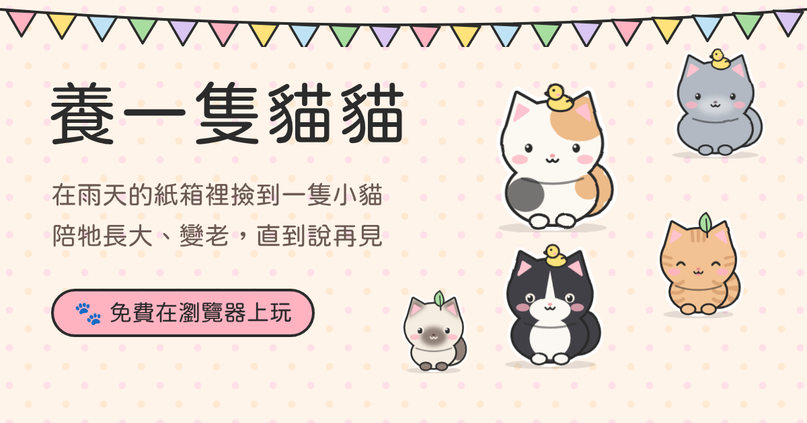

# 養一隻貓貓 · Raise a Kitty · ねこを飼おう



下雨的晚上，你在巷口的紙箱裡撿到一隻小貓。陪牠從小貓長到老貓，摸摸牠、餵牠、陪牠玩，一起經歷生活裡的大小事，直到牠對你說：「謝謝你，陪我一生。」

👉 **立即玩：https://mochachen1225-create.github.io/cat/**（English: `/cat/en.html` · 日本語: `/cat/ja.html`）

免費、不用下載、不用註冊，手機和電腦的瀏覽器都能玩。進度會自動存在你自己的瀏覽器裡。

## 玩法

- **撿到一隻貓**：花色隨機（橘貓、三花、賓士、暹羅、玳瑁……共 11 種），也可以上傳自家貓咪的照片，照片會剪成貓咪形狀，還能拖曳、縮放調整位置。
- **每天照顧牠**：一天分早上、下午、晚上，可以餵食（乾乾、罐罐、肉泥）、玩逗貓棒、梳毛、清貓砂、看醫生。點貓就能摸摸，會喵喵叫、呼嚕；摸肚子小心被咬。
- **不要讓狀態變紅色**：飽足、心情、清潔、健康、親密五條狀態。貓砂太髒會尿在床上，太久沒吃飯會餓到倒地送急診，每次都會讓貓少活幾年。
- **選擇會有後果**：出國要請保母還是送旅館？沒打預防針、不結紮、拖著不看醫生，幾天後都會找上門。
- **貓咪的日常**：半夜踩奶、凌晨鬼叫、推杯子、送你蟑螂、坐在鍵盤上、跳上聖誕樹……
- **快轉**：按一次就一直快轉，遇到事件會暫停，處理完自動繼續。
- **用品店**：每天領薪水，買貓跳台、吊床、飲水機、自動貓砂機等 14 樣東西佈置房間，每樣都有每日效果。
- **到最後**：貓會寫一封信給你，裡面是你們一起的回憶。家具和存款會留著，下一隻貓搬進同一個家；以前的貓都在「彩虹橋」裡。

## 檔案

| 檔案 | 用途 |
|---|---|
| `index.html` | 遊戲本體（中文，原始檔） |
| `en.html`、`ja.html` | 英文、日文版，由 `tools/build-i18n.py` 自動產生，不要手動改 |
| `i18n/en.json`、`i18n/ja.json` | 英文、日文翻譯（中文原文 → 翻譯） |
| `og.png` | 分享到社群時的預覽圖 |

### 修改中文後更新英日文

```bash
python3 tools/build-i18n.py extract   # 列出所有中文字串到 i18n/catalog.json
# 在 i18n/en.json、i18n/ja.json 補上新增或改過的字串
python3 tools/build-i18n.py build     # 重新產生 en.html、ja.html，會列出還沒翻譯的字串
```

## 上線（GitHub Pages）

1. 到 repo 的 **Settings → Pages**
2. **Source** 選 **Deploy from a branch**，Branch 選 `claude/epic-albattani-fbtyu0`、資料夾選 `/ (root)`，按 **Save**
3. 等一兩分鐘，網址就是 https://mochachen1225-create.github.io/cat/

所有東西都在 HTML 檔裡，不需要伺服器或安裝任何套件。

---

用 [Claude Code](https://claude.ai/code) 製作。
